# Inventory & Sales Management System

Aplikasi manajemen stok dan penjualan untuk usaha distribusi kecil.
Dibuat sebagai UTS Web Programming 2 (Integrated Laravel Project).

## 1. Project Overview

Sistem mencatat master data (kategori, produk, supplier), transaksi pembelian
(stock-in) dan penjualan (stock-out) dengan stok yang berubah otomatis dan konsisten.
Dua peran pengguna sesuai brief: **Admin/Owner** dan **Staff**. Sebagai fitur tambahan
ada peran **Customer** yang mendaftar sendiri dan membeli lewat katalog.

## 2. Requirements

- PHP 8.2+
- Composer
- MySQL 8 / MariaDB
- Node.js dan npm

## 3. Installation

```bash
git clone https://github.com/darkkausar789-del/inventory-sales.git
cd inventory-sales

composer install
cp .env.example .env
php artisan key:generate
npm install
npm run build
```

## 4. Environment Setup

Buat database kosong bernama `inventory_sales` (misalnya lewat phpMyAdmin),
lalu sesuaikan kredensial di `.env`:

```
DB_CONNECTION=mysql
DB_HOST=127.0.0.1
DB_PORT=3306
DB_DATABASE=inventory_sales
DB_USERNAME=root
DB_PASSWORD=
```

## 5. Migration & Seeding

```bash
php artisan migrate --seed
php artisan serve
```

Jalankan `npm run build` (sudah di langkah Installation) agar tampilan Tailwind/Vite
termuat. Untuk pengembangan bisa memakai `npm run dev`.

Buka http://127.0.0.1:8000

## 6. Demo Account

| Role  | Email               | Password |
|-------|---------------------|----------|
| Admin | admin@example.com   | password |
| Staff | staff@example.com   | password |
| Customer | pelanggan@example.com | password |

Customer baru juga bisa mendaftar sendiri lewat halaman Register (selalu dibuat sebagai
Customer, role tidak bisa diinjeksi lewat input).

Akun di atas hanya data dummy untuk demo.

## 7. Features

- Autentikasi (login/logout, password di-hash, CSRF)
- Role-based access (Admin dan Staff), dijaga di server lewat middleware
- CRUD kategori, produk (soft delete), supplier, dan pengguna (khusus Admin)
- Pembelian: banyak item per transaksi, stok bertambah
- Penjualan: banyak item per transaksi, stok berkurang, ditolak jika stok tidak cukup
- Semua transaksi memakai `DB::transaction` dan `lockForUpdate()` (atomik, anti-overselling)
- Total dan harga jual dihitung server, bukan dari input browser
- Tambahan: peran Customer (register, katalog tanpa harga beli dan produk habis, beli banyak item)
- Pembatalan transaksi (Admin) yang mengembalikan stok secara konsisten
- Search, filter (kategori, status, tanggal, stok rendah), dan pagination
- Dashboard dengan query agregat dari database
- 30 automated test (`php artisan test`)

### Pembagian akses

| Fitur | Admin | Staff |
|-------|:-----:|:-----:|
| Kategori, supplier, pengguna | CRUD | Tidak ada akses |
| Produk | CRUD | Lihat saja |
| Pembelian / penjualan | Lihat semua, buat, batalkan | Buat dan lihat milik sendiri |
| Dashboard | Ya | Ya |
| Katalog dan pembelian sendiri | - | - |

Customer hanya dapat membuka katalog dan membeli; halaman internal ditolak. Customer tidak dapat membatalkan pesanan, hanya Admin/Owner.

## 8. Business Rules

- SKU produk unik (validasi Laravel dan unique constraint database)
- Kuantitas transaksi > 0, harga >= 0
- Penjualan tidak boleh melebihi stok
- Stok hanya berubah lewat transaksi (tidak bisa diedit manual)
- Produk yang sudah dipakai transaksi tidak dapat dihapus
- Pembatalan pembelian ditolak jika stoknya sudah terpakai (stok tidak boleh negatif)

## 9. ERD

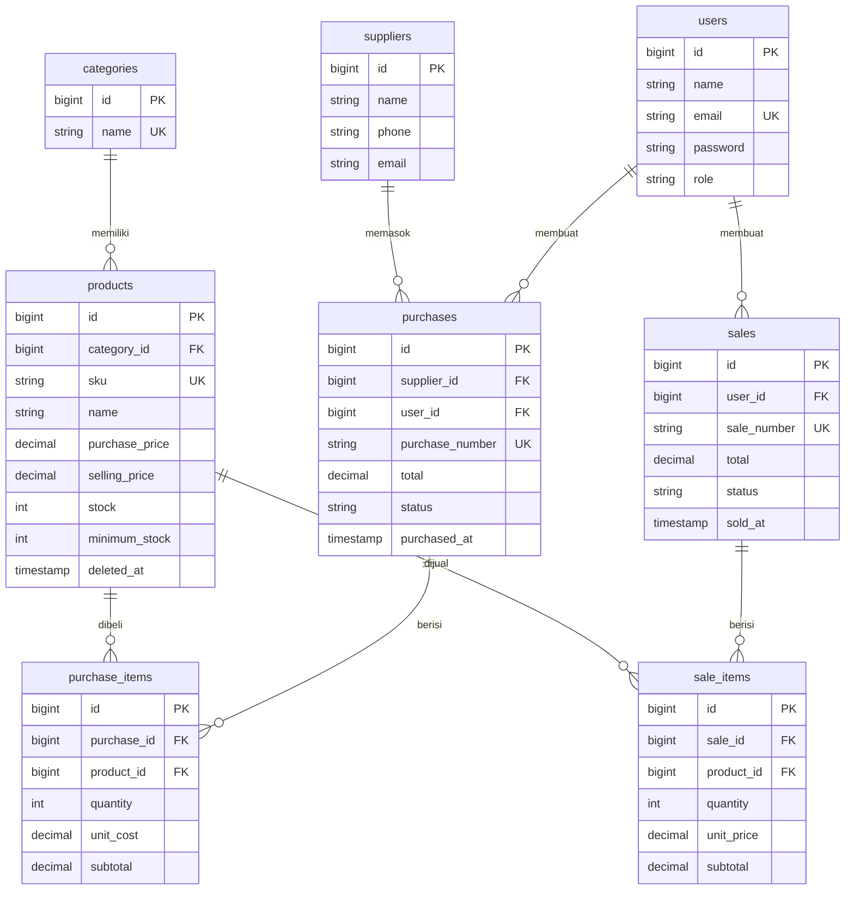

### Relasi Eloquent

- `Category hasMany Product`, `Product belongsTo Category`
- `Supplier hasMany Purchase`, `Purchase belongsTo Supplier`
- `Purchase hasMany PurchaseItem`, `PurchaseItem belongsTo Purchase / Product`
- `Sale hasMany SaleItem`, `SaleItem belongsTo Sale / Product`
- `User hasMany Sale / Purchase`

Foreign key berada di tabel detail ("banyak") karena satu baris induk dirujuk
banyak baris detail; satu kolom tidak dapat menyimpan banyak ID.

## 10. Testing

```bash
php artisan test
```

Test berjalan di database SQLite in-memory, sehingga data MySQL tidak tersentuh.
Skenario yang diuji: autentikasi, validasi produk (SKU duplikat, harga negatif),
pembelian menambah stok, penjualan mengurangi stok, stok tidak cukup,
rollback transaksi (atomicity), otorisasi Admin/Staff, serta search, filter,
dan pagination. Peran Customer diuji terpisah: register aman dari injeksi role,
akses halaman internal ditolak, katalog menyembunyikan stok habis dan harga beli,
serta pembelian multi-item mengurangi stok.

## 11. Screenshots

### Login
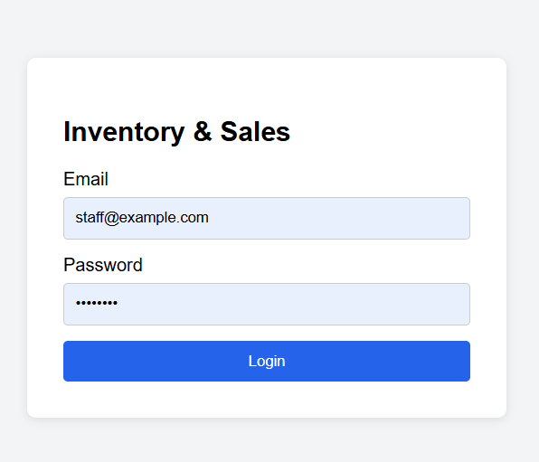

### Dashboard
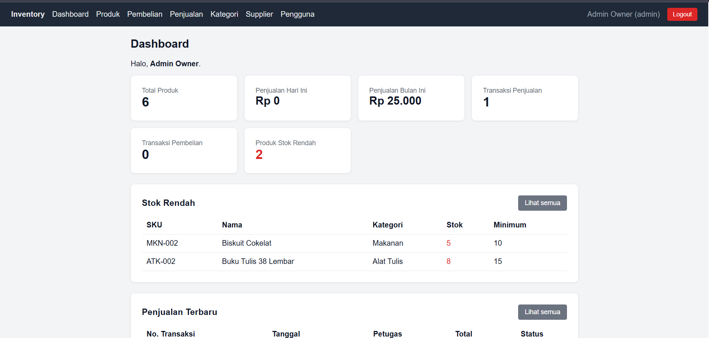

### Daftar Produk
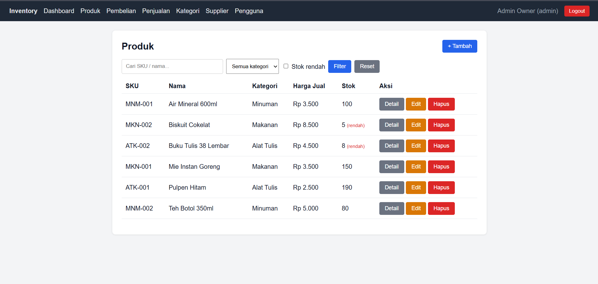

### Pembelian Baru
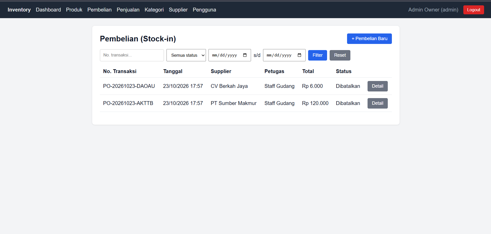

### Penjualan Baru
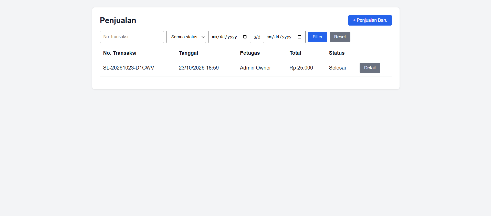

### Detail Penjualan
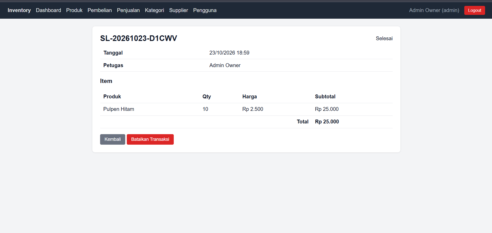

### Penolakan Stok Tidak Cukup
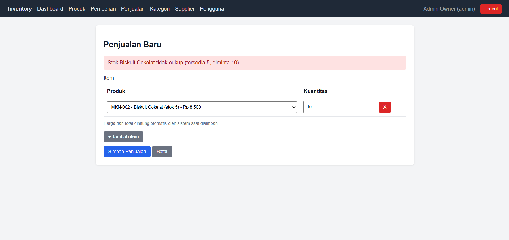

### Manajemen Pengguna (Admin)
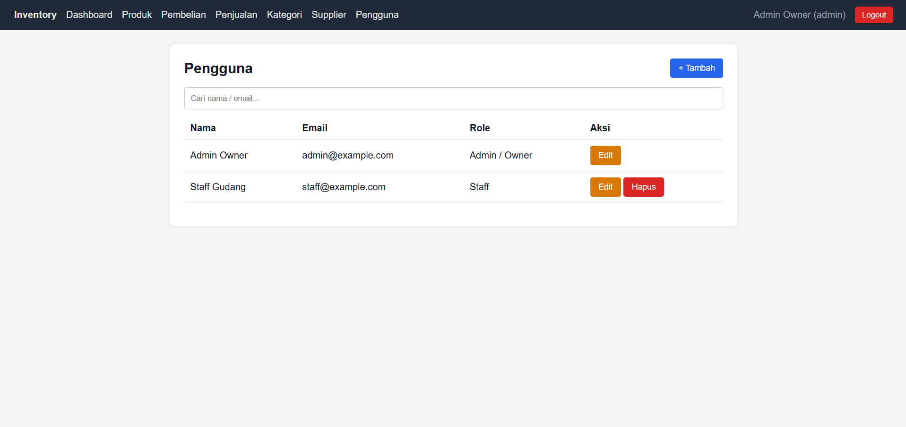

### Akses Staff Ditolak (403)
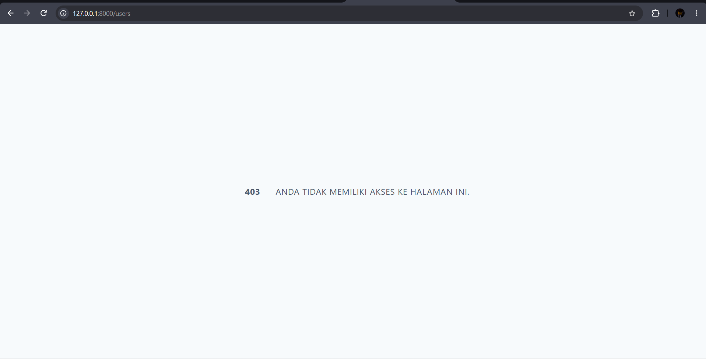

### Hasil Automated Test
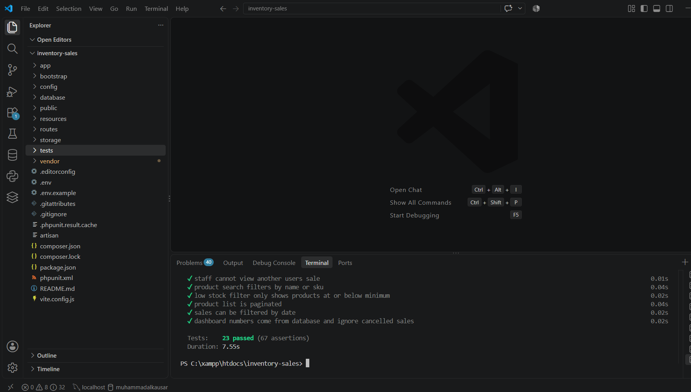

## 12. Known Limitations

- Belum ada fitur nonaktifkan pengguna (hanya hapus jika belum punya transaksi)
- Belum ada halaman laporan dan ekspor
- Tampilan sederhana (navigasi atas), belum dioptimalkan penuh untuk mobile
- Satu gudang, satu mata uang